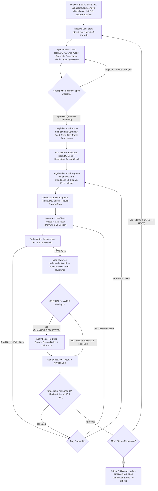

# Agentic Engineering Flow (`FLOW.md`)

**Project:** Multi-Country Car Insurance Quoting Wizard (`CO` / `CL`) — Angular 21+ & Strapi 5+  
**Repository:** `multi-country-car-insurance`  
**Methodology:** Custom Lightweight Spec-Driven Development (SDD) — Human-Gated Hybrid Flow  

---

## 1. Methodology & Tooling Justifications

### 1.1 Why Custom Lightweight SDD (No External Framework)
Instead of adopting a rigid framework such as **Spec Kit** or **Kiro**, this project implements a custom, file-based **Spec-Driven Development (SDD)** pipeline documented in [`ADR-003`](docs/adrs/ADR-003-frontend-persistence-and-sdd-workflow.md):

- **Zero tooling lock-in:** Specs, ADRs, subagent prompts, skills, review reports, and unedited session logs live directly as plain Markdown and JSON inside Git.
- **Explicit traceability chain:** Every user story traverses an auditable path from requirements to QA sign-off:  
  `User Story` → `Spec` → `ADR` → `Code` → `Tests (Unit + E2E)` → `Code Review` → `Fix Commits`.
- **Single-source-of-truth specs:** Each story (`US-01`, `US-02`, `US-03`) undergoes upfront gap analysis (`G1..Gn`), explicit state/accessibility contracts, and verifiable test matrices (`US*-U*` / `US*-E*`) **before** any implementation begins.

### 1.2 Why Hybrid Orchestration (Antigravity + OpenCode CLI)
We selected a hybrid two-layer setup combining **Google Antigravity** (interactive orchestrator & human checkpoint interface) with **OpenCode CLI** (headless, reproducible subagent execution):

1. **Clear separation of responsibilities:** Antigravity acts as Coordinator—managing phases, enforcing human gates, verifying real builds/containers on Windows + Docker, and maintaining Git hygiene—while OpenCode executes specialized, role-scoped subagents defined in `.opencode/agents/*.md`.
2. **Versioned domain knowledge:** Two reusable skills encapsulate Strapi 5+ and Angular 21+ constraints (`strapi-multi-country` and `angular-dynamic-wizard`), preventing drift across increments.
3. **Unedited session auditability:** Running subagents through OpenCode CLI (`opencode run --agent ...`) enables verbatim JSON exports via `opencode session export --standalone` saved unedited in [`docs/session-logs/`](docs/session-logs/).

### 1.3 LLM Model & Free-Tier Disclosure
Per the technical assessment rules (*"If a tool requires a paid plan and you don't have access, use a free alternative and say so"*):

- No paid OpenCode provider subscriptions were used for subagent runs.
- Initial Phase 1A (`ADR` drafting) and `US-01` runs used **`opencode/deepseek-v4.1-flash-free`**.
- After exhausting the free-tier usage limit on `opencode/deepseek-v4.1-flash-free` during `US-02`, all subsequent OpenCode subagent runs (`US-02` implementation/tests/review and all `US-03` phases) switched cleanly to OpenCode's available free fallback model, **`opencode/big-pickle`**, with zero relaxation of specs, tests, or review gates.

---

## 2. Subagent Architecture & Role Boundaries

| Subagent (`.opencode/agents/`) | Primary Responsibility | Allowed Modification Scope | Domain Skills Loaded |
| --- | --- | --- | --- |
| [`spec-analyst`](.opencode/agents/spec-analyst.md) | Drafts MADR ADRs (`ADR-001..003`) and story specifications (`specs/US-*.md`), identifying edge cases and open checkpoint questions | `docs/adrs/*.md`, `specs/*.md` | Optional context reading |
| [`strapi-dev`](.opencode/agents/strapi-dev.md) | Builds Strapi 5 content-type schemas, idempotent `CO`/`CL` seed data, and programmatic read-only `Public` permissions | `backend/**` | `strapi-multi-country` |
| [`angular-dev`](.opencode/agents/angular-dev.md) | Implements Angular 21 standalone/signals wizard UI, pure helpers, `WizardStore`, `CatalogueApi`, guards, and accessibility | `frontend/src/app/**` (excluding `*.spec.ts`) | `angular-dynamic-wizard` |
| [`tester-dev`](.opencode/agents/tester-dev.md) | Authors independent Vitest unit specs and Playwright E2E specs mapped 1-to-1 to `US*-U*` / `US*-E*` matrices | `frontend/src/**/*.spec.ts`, `frontend/e2e/**/*.spec.ts` | `angular-dynamic-wizard`, `strapi-multi-country` |
| [`code-reviewer`](.opencode/agents/code-reviewer.md) | Performs read-only security, spec-compliance, Angular/Strapi standards, accessibility, and test audits | `docs/reviews/*.md` only | `angular-dynamic-wizard`, `strapi-multi-country` |

Global rules across all agents are governed by [`AGENTS.md`](AGENTS.md) (security, zero tokens in browser, flattened Strapi 5 handling, localized `es-CO`/`es-CL` runtime copy vs English technical artifacts, and strict PII prohibition).

---

## 3. End-to-End Agentic Flow Diagram

---

## 4. Step-by-Step Flow: From Functional User Story to QA Handoff

| Step | Description | AI used? | AI, agent, subagent or skill used | Deliverable produced | Human in the loop |
| --- | --- | --- | --- | --- | --- |
| **0. Repo & Agentic Foundation** | Initialize repository, define global agent conventions (`AGENTS.md`), version 5 specialized subagents and 2 reusable skills, and record user stories `US-01..US-03`. | Yes | Antigravity (planning & authoring) + `opencode debug agents` CLI validation | [`AGENTS.md`](AGENTS.md), [`.opencode/agents/*.md`](.opencode/agents/), [`.opencode/skills/*/SKILL.md`](.opencode/skills/), [`docs/user-stories/US-01..03.md`](docs/user-stories/) (`520cd39`, `7d4a226`) | **Checkpoint 1:** User approves hybrid Antigravity + OpenCode approach, language split (English code/docs, localized `es-CO`/`es-CL` UI), and explicitly mandates adding `tester-dev` for test separation. Rejections modify agent/skill files before Phase 1. |
| **1A. Architecture Decisions (ADRs)** | Analyze multi-country content strategy, Strapi Public permissions & zero-token security, and browser persistence + SDD workflow with real alternatives & consequences. | Yes | OpenCode `spec-analyst` (`opencode/deepseek-v4.1-flash-free`) + Antigravity | [`ADR-001`](docs/adrs/ADR-001-multi-country-content-strategy.md), [`ADR-002`](docs/adrs/ADR-002-strapi-security-and-permissions.md), [`ADR-003`](docs/adrs/ADR-003-frontend-persistence-and-sdd-workflow.md), [`01-phase1a-adrs-spec-analyst.json`](docs/session-logs/01-phase1a-adrs-spec-analyst.json) (`5f0e7af`, `1c68df4`) | **Checkpoint 2:** User resolves open architectural questions (automatic `/` → `/co/quote` redirect, zero API tokens in browser, 2-hour idle TTL per-country `sessionStorage`, Critical/Major review blocking) and accepts all 3 ADRs. |
| **1B. Environment Scaffold** | Scaffold Strapi 5.63, Angular 21.0, multi-stage Dockerfiles, Nginx SPA routing, ephemeral runtime secret generator, and `docker-compose.yml` single-command setup. | Hybrid | Antigravity + deterministic Docker Compose build & healthcheck | [`docker-compose.yml`](docker-compose.yml), [`.env.example`](.env.example), [`backend/`](backend/), [`frontend/`](frontend/) (`d2ff64d`) | Human inspects baseline repository hygiene (zero `.env` committed). |
| **2. Story Gap Analysis & Spec** *(per US)* | Read the functional user story, inspect existing code contracts, document gaps (`G1..Gn`), define Strapi/TS/UI contracts, and author unit (`US*-U*`) + E2E (`US*-E*`) acceptance matrices. | Yes | OpenCode `spec-analyst` (`deepseek-v4.1-flash-free` on `US-01`; `big-pickle` on `US-02`/`US-03`) | [`specs/US-01-policyholder-vehicle-form.md`](specs/US-01-policyholder-vehicle-form.md), [`specs/US-02-plan-list.md`](specs/US-02-plan-list.md), [`specs/US-03-summary-and-payment.md`](specs/US-03-summary-and-payment.md), session logs `02`, `07`, `12` | **Checkpoint 3 (per story):** User reviews spec and answers story-specific Open Questions (e.g. CO/CL validations, simulated pricing formula, Step 2/3 bridge boundaries, simulated terms policy, non-UI Option A failure hook). On rejection, `spec-analyst` revises before coding starts. |
| **3. Strapi Backend Implementation** *(per US)* | Create/update Strapi 5 content types (`form-field`, `country-config`, `insurance-plan`), idempotent `CO`/`CL` bootstrap seed data, and programmatic read-only Public permissions (`6` actions max). | Yes | OpenCode `strapi-dev` + skill `strapi-multi-country` (`deepseek-v4.1-flash-free` on `US-01`; `big-pickle` on `US-02`/`US-03`) | [`backend/src/api/**`](backend/src/api/), [`backend/src/bootstrap/**`](backend/src/bootstrap/), session logs `03`, `08`, `13` (`c5c3f33`, `e209584`, `977a178`) | **None (automated verification):** Orchestrator wipes/rebuilds Docker Strapi volume (`docker compose down -v`), verifies seeded JSON endpoints, tests `403` on writes/`/users`, and confirms restart idempotency before Angular starts. |
| **4. Angular Frontend Implementation** *(per US)* | Build standalone `OnPush` components, signals store (`WizardStore`), `CatalogueApi` single `/api/` gateway, pure pricing/summary/masking helpers, guards, ARIA wiring, and responsive CSS. | Yes | OpenCode `angular-dev` + skill `angular-dynamic-wizard` (`deepseek-v4.1-flash-free` on `US-01`; `big-pickle` on `US-02`/`US-03`) | [`frontend/src/app/**`](frontend/src/app/), session logs `04`, `09`, `14` (`7fa1188`, `9e65402`, `e8e32ba`) | **None (automated verification):** Orchestrator independently executes `lint:api-guard`, `ng build` (prod + dev), existing Vitest suite, and rebuilds Docker (`docker compose up --build -d`). |
| **5. Independent Testing (Unit & E2E)** *(per US)* | Author Vitest unit specs and Playwright Chromium E2E specs in separate files without altering production source; validate CO & CL paths, keyboard navigation, ARIA, responsiveness, and security against live Docker. | Yes | OpenCode `tester-dev` + both domain skills (`deepseek-v4.1-flash-free` on `US-01`; `big-pickle` on `US-02`/`US-03`) | [`frontend/src/app/**/*.spec.ts`](frontend/src/app/), [`frontend/e2e/*.spec.ts`](frontend/e2e/), session logs `05`, `10`, `15` (`a57a1c4`, `76f5d97`, `0dd6857`) | **None (automated verification):** Orchestrator independently runs `npm run lint:api-guard`, `npm test -- --watch=false`, and `npm run e2e` with 0 failures and 0 skipped tests. |
| **6. Independent Code Review** *(per US)* | Inspect increment commits (`docs/session-logs/*` excluded), run static security/Angular/Strapi scans, verify tests, classify findings (`CRITICAL`/`MAJOR`/`MINOR`/`INFO`), and issue verdict. | Yes | OpenCode `code-reviewer` + both domain skills (`deepseek-v4.1-flash-free` on `US-01`; `big-pickle` on `US-02`/`US-03`) | [`docs/reviews/US-01-review.md`](docs/reviews/US-01-review.md), [`US-02-review.md`](docs/reviews/US-02-review.md), [`US-03-review.md`](docs/reviews/US-03-review.md), session logs `06`, `11`, `16` | Automated quality gate: any `CRITICAL` or `MAJOR` finding blocks Checkpoint 4 until fixed and verified. |
| **7. Finding Resolution & Re-Verification** *(per US)* | Fix code review findings (`US-01` F-01..F-03 + dev build defect; `US-02` F-01 lowest-`id` dedup; `US-03` F-01 spec amendment + guard tests & F-02 responsive assertions), rebuild Docker, re-run all checks, and mark review `APPROVED`. | Hybrid | Antigravity (targeted code/test/doc fixes + full check re-runs) | Fix commits `2e514b4`, `ab2cb67`, `34579e8`; updated review statuses (`3e0623b`, `cc0fbe9`, `583d8fe`) | Orchestrator verifies every fix commit hash directly in Git before marking findings `RESOLVED`. |
| **8. QA Acceptance Gate** *(per US)* | Present live running application (`:4200` / `:1337`), review verdict, test results, and manual verification steps in user's preferred language. | No | Human QA verification + Antigravity status presentation | Approved increment ready for next story or final release | **Checkpoint 4 (per story):** Project owner manually tests CO & CL flows in browser and approves closure before moving to the next user story (`US-01` → `US-02` → `US-03` → Release). On rejection, returns to Step 4/5/7. |
| **9. Final Docs, Verification & Git Push** | Author `FLOW.md`, update `README.md` with complete instructions/status, verify secret hygiene & full test suite, and push `main` to GitHub. | Hybrid | Antigravity + deterministic CLI checks (`git`, `docker`, `npm`) | [`FLOW.md`](FLOW.md), [`README.md`](README.md), pushed remote branch `main` | Human reviews final deliverables and GitHub repository. |

---

## 5. End-to-End Traceability Map

Every artifact and commit is traceable across all three user stories:

| Increment | Story | Approved Spec | ADRs | Implementation Commits | Test Commits | Code Review & Fix Commits | OpenCode Session Logs (Unedited JSON) |
| --- | --- | --- | --- | --- | --- | --- | --- |
| **Phase 0 & 1** | Setup | — | [`ADR-001..003`](docs/adrs/) (`5f0e7af`, `1c68df4`) | `520cd39`, `7d4a226`, `d2ff64d` | — | — | [`01-phase1a-adrs-spec-analyst.json`](docs/session-logs/01-phase1a-adrs-spec-analyst.json) |
| **`US-01`** | [`US-01.md`](docs/user-stories/US-01.md) | [`US-01-policyholder-vehicle-form.md`](specs/US-01-policyholder-vehicle-form.md) (`f7c3334`, `f298624`) | `ADR-001..003` | Strapi `c5c3f33`; Angular `7fa1188` | `a57a1c4`, `2e514b4` (E2E) | [`US-01-review.md`](docs/reviews/US-01-review.md) (`81b2544`, `2e514b4`, `3e0623b`) | [`02`](docs/session-logs/02-phase2-us01-spec-analyst.json), [`03`](docs/session-logs/03-us01-strapi-dev.json), [`04`](docs/session-logs/04-us01-angular-dev.json), [`05`](docs/session-logs/05-us01-tester-dev.json), [`06`](docs/session-logs/06-us01-code-reviewer.json) |
| **`US-02`** | [`US-02.md`](docs/user-stories/US-02.md) | [`US-02-plan-list.md`](specs/US-02-plan-list.md) (`662ae25`, `3296542`) | `ADR-001..003` | Strapi `e209584`; Angular `9e65402` | `76f5d97` | [`US-02-review.md`](docs/reviews/US-02-review.md) (`881caa3`, `ab2cb67`, `cc0fbe9`) | [`07`](docs/session-logs/07-phase2-us02-spec-analyst.json), [`08`](docs/session-logs/08-us02-strapi-dev.json), [`09`](docs/session-logs/09-us02-angular-dev.json), [`10`](docs/session-logs/10-us02-tester-dev.json), [`11`](docs/session-logs/11-us02-code-reviewer.json) |
| **`US-03`** | [`US-03.md`](docs/user-stories/US-03.md) | [`US-03-summary-and-payment.md`](specs/US-03-summary-and-payment.md) (`185cb43`, `9d33615`) | `ADR-001..003` | Strapi `977a178`; Angular `e8e32ba` | `0dd6857` | [`US-03-review.md`](docs/reviews/US-03-review.md) (`e217efd`, `cdf148b`, `34579e8`, `583d8fe`) | [`12`](docs/session-logs/12-phase2-us03-spec-analyst.json), [`13`](docs/session-logs/13-us03-strapi-dev.json), [`14`](docs/session-logs/14-us03-angular-dev.json), [`15`](docs/session-logs/15-us03-tester-dev.json), [`16`](docs/session-logs/16-us03-code-reviewer.json) |

---

## 6. Flow Reflection & Lessons Learned

### 6.1 What would we do differently if a team of 5 developers used this flow?
1. **Branching, PRs & CODEOWNERS:** Replace sequential `main` commits with short-lived feature branches (`feat/US-XX-*`) and Pull Requests protected by `CODEOWNERS` on governing artifacts (`AGENTS.md`, `.opencode/**`, `docs/adrs/**`, `specs/**`). Automated review (`code-reviewer`) and human Checkpoint 4 sign-off would map directly to PR review comments and branch protection gates.
2. **Parallel isolation via Git worktrees & project-scoped Docker stacks:** Give each developer an isolated Git worktree and distinct Docker Compose project names/ports (`COMPOSE_PROJECT_NAME`, dynamic host ports) so multiple stories (`US-01`–`US-03`, or backend vs frontend slices) can run local Strapi + Playwright E2E stacks concurrently without SQLite lock contention or port `:1337`/`:4200` collisions.
3. **CI/CD pipeline enforcement:** Run `npm run lint:api-guard`, `ng build` (prod + dev), Vitest, Playwright E2E against ephemeral containerized Strapi, and Strapi idempotency checks in CI on every PR rather than relying on local orchestrator discipline.
4. **Shared non-prod CMS & secret management:** Maintain a shared staging Strapi database managed by the business team (separate from ephemeral CI seed volumes) and move Strapi admin/CI secrets to an OIDC/vault provider.
5. **Cross-story contract locking:** Freeze typed OpenAPI/DTO schemas or contract snapshot tests whenever two developers touch adjacent wizard steps concurrently.

### 6.2 Which part of the flow did not work as expected and how did we adjust it?
Several concrete friction points emerged during execution, and every one forced an explicit process or architectural adjustment:

1. **Test-ownership separation (`Checkpoint 1`):** Our initial draft let feature devs (`angular-dev`) write unit tests alongside code. At Checkpoint 1, the human reviewer required strict separation—so we created the dedicated [`tester-dev`](.opencode/agents/tester-dev.md) subagent (`7d4a226`) restricted exclusively to `*.spec.ts` and `e2e/*.spec.ts`. That separation immediately paid off: in `US-01`, `tester-dev` caught a circular self-import bug in `environment.development.ts` that production builds hadn't exercised.
2. **Strapi 5 reserved attribute names (`locale` & `status`):** Strapi 5's `draftAndPublish` engine reserves both `locale` and `status` attribute names at schema compile time (`RESERVED_ATTRIBUTE_NAMES`). When `strapi-dev` hit schema rejection on `country-config.locale` and `US-02` design checked `active` status, we adjusted the contracts in specs and schemas to `localeCode` (`country-config`) and `active` (`insurance-plan`)—and documented this invariant in [`strapi-multi-country/SKILL.md`](.opencode/skills/strapi-multi-country/SKILL.md) so later runs never repeated it.
3. **Free-tier LLM quota exhaustion (`deepseek-v4.1-flash-free` → `big-pickle`):** Mid-way through `US-02`, `opencode/deepseek-v4.1-flash-free` hit its free-tier rate/usage limit. Instead of halting or weakening review depth, we switched OpenCode execution to `opencode/big-pickle`, verified `opencode debug agents` and full JSON session exports remained intact, and documented the model switch explicitly in `FLOW.md` and `README.md`.
4. **Headless OpenCode CLI stdin & tool-permission traps on Windows:** Running `opencode run` without piped stdin blocked waiting on input, and invoking Web Search inside unattended runs failed with `Cancelled a request for input this run cannot answer: Web Search`. We standardized prompting by writing structured task briefs to scratch files, piping stdin cleanly (`$prompt | opencode run ...`), adding explicit *"Do NOT use Web Search or Web Fetch"* constraints, and using `--standalone` when listing/exporting OpenCode sessions cleanly on Windows.
5. **Real defects surfaced by `code-reviewer` and E2E gates (which would otherwise reach QA):**
   - **`US-01` (`2e514b4`):** `code-reviewer` flagged wrong tie-break ordering in field deduplication (`F-01`), missing Playwright E2E automation (`F-02`), and missing automated `/api/` literal checks (`F-03` → added `npm run lint:api-guard`).
   - **`US-02` (`ab2cb67`):** `code-reviewer` caught `CatalogueApi.mapPlans()` sorting by `order` *before* deduplicating by `documentId`, which kept a higher-`id` duplicate instead of the spec-mandated lowest `id`. Both code and unit tests were fixed and re-verified against Docker.
   - **`US-03` (`34579e8` & E2E refinement):** Cold browser reload onto `/summary` required hydrating persisted plans inside `step2CompleteGuard`, which `code-reviewer` rightly flagged as a spec-drift minor (`F-01` → amended `specs/US-03-summary-and-payment.md` + added guard unit tests), alongside hardening `US03-E16` responsive assertions (`F-02`) and fixing a keyboard `Tab`-before-enabled timing race in `US03-E15`.
6. **Windows host vs Linux container native bindings (`better-sqlite3`):** Running Strapi builds on the Windows host failed due to Linux container vs Windows native SQLite compilation differences; we enforced container-exclusive Strapi verification (`docker compose up --build -d strapi`) inside both `strapi-dev` instructions and orchestrator gates.

### 6.3 At which points did we decide NOT to use AI and why?
1. **Product, Security & UX Governance (Human Checkpoints 1–4):** Humans—never AI—chose the agent topology (adding `tester-dev`), approved security/persistence rules (`/` → `/co/quote` redirect, zero tokens in browser, 2h `sessionStorage` TTL), answered open questions in each spec (`Q1`–`Q4` at Checkpoint 3), and executed live browser acceptance before signing off Checkpoint 4.
2. **Independent Build, Container & Test Verification:** Subagent self-reports were **never** treated as proof of passing. The orchestrator independently ran deterministic CLI commands (`docker compose down -v`, `npm run lint:api-guard`, `ng build`, `ng test --watch=false`, Playwright `npm run e2e`, and Strapi HTTP permission checks) after every code or review fix commit.
3. **Secrets, Ephemeral Keys & Git Hygiene:** Docker container runtime secrets are generated ephemerally via shell script ([`backend/docker-entrypoint.sh`](backend/docker-entrypoint.sh)) without AI involvement, `.gitignore` enforces `.env` exclusion deterministically, and Git staging/commits/remote pushes remain deterministic CLI operations after passing checks.
